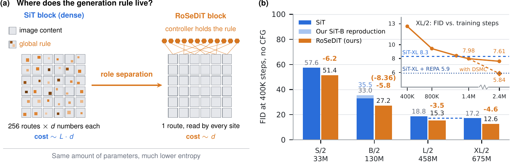
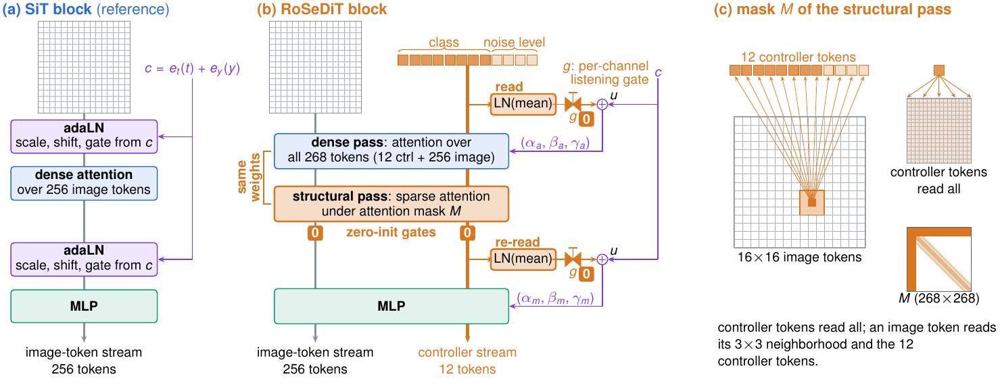
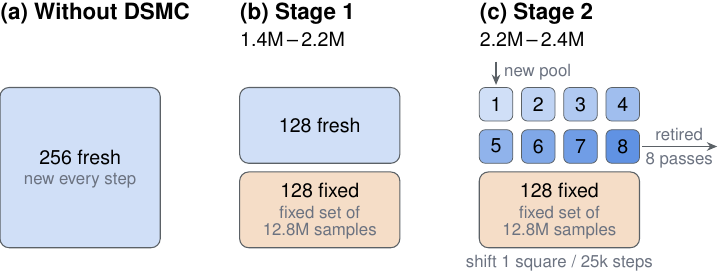

# RoSeDiT: Role-Separated Diffusion Transformers



Official code for **Role-Separated Diffusion Transformers: Global Rule Isolation and Deterministic Sampling Manifold
Compression** (Zhiguang Liu, Yi Shang; University of Missouri).

RoSeDiT is a diffusion transformer architecture that isolates the global rule from the image tokens. In
class-conditional DiT and SiT, the class and the noise level are explicitly conditioned by adaLN, so a RoSeViT-style
controller channel on the ViT side is insufficient to establish the full role separation. By introducing the adaLN
listening mechanism, which makes adaLN compute under the controller's command, RoSeDiT brings the entropy theorem and
role separation into the latent diffusion domain.



RoSeDiT realizes global rule isolation through three components. Twelve controller tokens maintain an evolving
representation of the global condition, a listening mechanism lets adaLN compute its modulation from their states, and a
structural pass restricts each image token to its 3x3 neighborhood and the controller tokens. RoSeDiT maintains the same
level of parameter count by reusing the dense attention weights.

Deterministic Sampling Manifold Compression (DSMC) is a two-stage training schedule for the continued training of
diffusion models. DSMC combines deterministic reuse of (image, noise level, noise) triples with stochastic sampling. It
changes which triples a batch contains and nothing else.



## Results (ImageNet 256x256, no classifier-free guidance)

FID is computed on 50,000 samples from EMA models with the ADM evaluation suite. Samples are generated with a 250-step
Euler-Maruyama SDE sampler. RoSeDiT is trained and evaluated under the SiT protocol with this code.

| Scale | Params | Steps | SiT | RoSeDiT |
|---|---|---|---|---|
| S/2 | 33M | 400K | 57.6 | **51.42** |
| B/2 | 130M | 400K | 33.0 | **27.18** |
| L/2 | 458M | 400K | 18.8 | **15.34** |
| XL/2 | 675M | 400K | 17.2 | **12.63** |
| B/2 + REPA | 130M | 400K | 24.4 | **21.01** |

SiT-B/2 reproduced with this code reaches 35.54.

| Model | Steps | Epochs | FID | sFID | IS | Prec. | Rec. |
|---|---|---|---|---|---|---|---|
| SiT-XL/2 | 7M | 1400 | 8.3 | 6.32 | 131.7 | .68 | .67 |
| RoSeDiT-XL/2 | 1.4M | 280 | 7.98 | 5.30 | 129.1 | .696 | .660 |
| RoSeDiT-XL/2 | 2.4M | 480 | 7.61 | 5.49 | 137.0 | .694 | .670 |
| SiT-XL/2 + REPA | 4M | 800 | 5.9 | 5.73 | 157.8 | .70 | .69 |
| RoSeDiT-XL/2 + DSMC | 2.4M | 480 | **5.84** | 4.67 | 150.4 | .708 | .666 |

At the same level of parameter count, RoSeDiT surpasses SiT at all four model scales at 400K steps, and RoSeDiT-L/2
even surpasses SiT-XL/2's 17.2 FID with 15.34 and 32% fewer parameters. RoSeDiT-XL/2 surpasses SiT-XL/2's 7M-step FID of
8.3 at 1.4M steps with 7.98, using one-fifth as many training steps. With DSMC, RoSeDiT-XL/2 surpasses SiT + REPA's
4M-step FID of 5.9 at 2.4M steps with 5.84.

## Environment

```bash
conda create -n rosedit python=3.12 -y
conda activate rosedit
pip install -r requirements.txt
```

`--qk-norm` uses `torch.nn.RMSNorm` and needs PyTorch 2.4 or later. The code was run with Python 3.12, PyTorch 2.11,
timm 1.0.29, diffusers 0.40 and accelerate 1.14.

## Dataset

The data pipeline is REPA's: ImageNet images are center-cropped to 256x256 and encoded once with the Stable Diffusion
VAE. Follow the [preprocessing guide](preprocessing/README.md) and pass the resulting folder as `--data-dir`.

## Checkpoints

EMA weights of the models in the tables above are at [lz7fdmu/RoSeDiT](https://huggingface.co/lz7fdmu/RoSeDiT).

| File | Model | Steps | FID | `--model` | Extra flags |
|---|---|---|---|---|---|
| `RoSeDiT-S-2_400K.pt` | RoSeDiT-S/2 | 400K | 51.42 | `SiT-BR-B1W-DG-S/2` | `--encoder-depth=4` |
| `RoSeDiT-B-2_400K.pt` | RoSeDiT-B/2 | 400K | 27.18 | `SiT-BR-B1W-DG-B/2` | `--encoder-depth=4` |
| `RoSeDiT-L-2_400K.pt` | RoSeDiT-L/2 | 400K | 15.34 | `SiT-BR-B1W-DG-L/2` | `--encoder-depth=8` |
| `RoSeDiT-XL-2_400K.pt` | RoSeDiT-XL/2 | 400K | 12.63 | `SiT-BR-B1W-DG-XL/2` | `--encoder-depth=8 --qk-norm` |
| `RoSeDiT-XL-2_1400K.pt` | RoSeDiT-XL/2 | 1.4M | 7.98 | `SiT-BR-B1W-DG-XL/2` | `--encoder-depth=8 --qk-norm` |
| `RoSeDiT-XL-2_2400K.pt` | RoSeDiT-XL/2 | 2.4M | 7.61 | `SiT-BR-B1W-DG-XL/2` | `--encoder-depth=8 --qk-norm` |
| `RoSeDiT-XL-2_DSMC_2400K.pt` | RoSeDiT-XL/2 + DSMC | 2.4M | 5.84 | `SiT-BR-B1W-DG-XL/2` | `--encoder-depth=8 --qk-norm` |
| `RoSeDiT-B-2_REPA_400K.pt` | RoSeDiT-B/2 + REPA | 400K | 21.01 | `SiT-BR-B1W-DG-B/2` | `--encoder-depth=4 --projector-embed-dims=768` |

```bash
hf download lz7fdmu/RoSeDiT --local-dir checkpoints
```

The files hold the EMA weights under the key `ema`, the format `generate.py` reads. RoSeDiT-XL/2 is trained with RMS
normalization of the attention queries and keys (`--qk-norm`), so the same flag is needed to load it.

## Sampling and evaluation

```bash
torchrun --nnodes=1 --nproc_per_node=1 generate.py \
  --model "SiT-BR-B1W-DG-XL/2" --qk-norm \
  --num-fid-samples 50000 \
  --ckpt checkpoints/RoSeDiT-XL-2_DSMC_2400K.pt \
  --path-type=linear \
  --encoder-depth=8 \
  --projector-embed-dims=None \
  --per-proc-batch-size=64 \
  --mode=sde \
  --num-steps=250 \
  --cfg-scale=1.0 \
  --global-seed=0
```

This writes 50,000 PNG files and one `.npz` archive under `samples/`. The archive is scored with the
[ADM evaluation suite](https://github.com/openai/guided-diffusion/tree/main/evaluations) against its ImageNet 256x256
reference batch:

```bash
python evaluator.py VIRTUAL_imagenet256_labeled.npz samples/<folder>.npz
```

`scripts/sample_50k.sh` wraps the sampling command for every released file. For classifier-free guidance, set
`--cfg-scale` and, for guidance on an interval of noise levels, `--guidance-high` (as in REPA).

The 50,000-sample archives behind RoSeDiT-XL/2 at 1.4M steps (7.98) and RoSeDiT-XL/2 + DSMC at 2.4M steps (5.84) are
at [lz7fdmu/RoSeDiT_samples](https://huggingface.co/datasets/lz7fdmu/RoSeDiT_samples), so these two numbers can be
recomputed without a GPU.

## Training

All models use REPA's training script with SiT's recipe: linear interpolation with velocity prediction, AdamW with a
constant learning rate of 1e-4 and no weight decay, a global batch size of 256, and an EMA with decay 0.9999.

```bash
accelerate launch train.py \
  --report-to="wandb" \
  --allow-tf32 \
  --mixed-precision="fp16" \
  --seed=0 \
  --path-type="linear" \
  --prediction="v" \
  --weighting="uniform" \
  --model="SiT-BR-B1W-DG-B/2" \
  --enc-type="None" \
  --proj-coeff=0.0 \
  --encoder-depth=4 \
  --compile \
  --output-dir="exps" \
  --exp-name="rosedit-b" \
  --data-dir=[YOUR_DATA_PATH]
```

- `--model`: `SiT-BR-B1W-DG-S/2`, `SiT-BR-B1W-DG-B/2`, `SiT-BR-B1W-DG-L/2`, `SiT-BR-B1W-DG-XL/2` (RoSeDiT at the four
  scales); see [Model names](#model-names) for the baselines and the ablation models.
- `--enc-type="None" --proj-coeff=0.0`: training without representation alignment. For RoSeDiT + REPA use
  `--enc-type="dinov2-vit-b" --proj-coeff=0.5 --encoder-depth=4` (B/2), as in REPA.
- `--batch-size` is the global batch size; it is divided over the processes of `accelerate launch`.
- `--qk-norm`: used for RoSeDiT-XL/2 only.
- Resuming: `--resume-step=N` continues from `exps/<exp-name>/checkpoints/<N>.pt`. Pass a new `--seed` when resuming.
  With the same seed, the run draws the same sequence of triples as before.
- Checkpoints written by `train.py` store the argument namespace. With PyTorch 2.6 or later, set
  `TORCH_FORCE_NO_WEIGHTS_ONLY_LOAD=1` to resume from them or to sample from them.

`scripts/` holds one launch script per model with the settings of the released checkpoints:

| Script | Model | Setting |
|---|---|---|
| `scripts/train_rosedit_s.sh` | RoSeDiT-S/2 | 1 GPU, batch 256, 400K steps |
| `scripts/train_rosedit_b.sh` | RoSeDiT-B/2 | 1 GPU, batch 256, 400K steps |
| `scripts/train_rosedit_b_repa.sh` | RoSeDiT-B/2 + REPA | 1 GPU, batch 256, 400K steps |
| `scripts/train_rosedit_l.sh` | RoSeDiT-L/2 | 1 GPU, batch 128 with 2 accumulation steps, 400K steps |
| `scripts/train_rosedit_xl.sh` | RoSeDiT-XL/2 | 4 GPUs, batch 256, `--qk-norm`, 2.4M steps |
| `scripts/train_dsmc_stage1.sh` | RoSeDiT-XL/2 + DSMC, Stage 1 | from the 1.4M-step checkpoint to 2.2M steps |
| `scripts/train_dsmc_stage2.sh` | RoSeDiT-XL/2 + DSMC, Stage 2 | from the 2.2M-step checkpoint to 2.4M steps |

### DSMC

DSMC continues a training checkpoint (model, EMA and optimizer state, as written by `train.py`) with the same recipe
and changes only the triples of each batch.

**Stage 1** (1.4M to 2.2M steps). Each batch of 256 holds 128 fresh triples and 128 triples from a fixed set of 12.8M
triples, traversed in shuffled order with one pass every 100K steps:

```bash
--resume-step=1400000 --resume-ckpt=exps/rosedit-xl/checkpoints/1400000.pt \
--fixed-set-seed=20261024 --fixed-set-steps=50000 --fixed-frac=0.5 \
--max-train-steps=2200000
```

**Stage 2** (2.2M to 2.4M steps). The fixed half continues. The other 128 triples are eight groups of 16; each group
draws from a pool of 400K fixed triples with one pass every 25K steps, a new pool enters the first group every 25K
steps, and a pool is retired after eight passes:

```bash
--resume-step=2200000 --resume-ckpt=exps/rosedit-xl-dsmc-stage1/checkpoints/2200000.pt \
--fixed-set-seed=20261027 --fixed-set-steps=3125 --rotate-sets=8 --rotate-window=25000 --rotate-start=2200000 \
--persist-sections=8 --persist-set-seed=20261024 --persist-set-steps=50000 \
--max-train-steps=2400000
```

A fixed triple is never stored: its VAE posterior sample, noise level and noise are regenerated from the seed and the
index of the triple. `--fixed-set-steps` is the size of a set in global batches (50,000 x 256 = 12.8M triples). The
training log reports the loss on fresh triples (`loss_fresh`) and on fixed triples (`loss_fixed`) separately.

## Model names

The `--model` names are the ones the models were trained under. The table maps them to the rows of the paper.

| `--model` | Paper | FID at 400K |
|---|---|---|
| `SiT-S/2`, `SiT-B/2`, `SiT-L/2`, `SiT-XL/2` | SiT | 35.54 (B/2, reproduced with this code) |
| `SiT-BR-B1W-DG-S/2` | RoSeDiT-S/2 | 51.42 |
| `SiT-BR-B1W-DG-B/2` | RoSeDiT-B/2 | 27.18 |
| `SiT-BR-B1W-DG-L/2` | RoSeDiT-L/2 | 15.34 |
| `SiT-BR-B1W-DG-XL/2` | RoSeDiT-XL/2 | 12.63 |
| `SiT-SP6-B/2` | RoSeViT (fixed adaLN) | 34.03 |
| `SiT-BR-C1W-B/2` | RoSeViT (fixed adaLN) + Listening (rank-64) | 27.92 |
| `SiT-CTRL-B/2` | SiT-B/2 + In-context controller | 34.17 |
| `SiT-BR-NS-B/2` | SiT-B/2 + In-context controller + Listening (rank-64) | 30.26 |
| `SiT-B-d15/2` | SiT-B/2 Depth (15) | 31.65 |
| `SiT-B-w864/2` | SiT-B/2 Width (864) | 33.83 |
| `SiT-ROSE-B/2` | RoSeDiT-Dualweight-B/2 | 26.44 |
| `SiT-ROSE-DP2-B/2` | RoSeDiT-Dualweight-B/2 - Mask | 27.98 |
| `SiT-ROSE-NC-B/2` | RoSeDiT-Dualweight-B/2 - Controller | 27.44 |
| `SiT-ROSE-DP2-NC-B/2` | RoSeDiT-Dualweight-B/2 - Both | 29.07 |

All B/2 models are trained with the command above (`--encoder-depth=4`, 400K steps) and their own `--model`.

## Acknowledgement

This repository is built on [REPA](https://github.com/sihyun-yu/REPA) (Yu et al., ICLR 2025): the training loop, the
samplers, the data pipeline, the preprocessing and the SiT model code are theirs. RoSeDiT changes `models/sit.py` and
adds the DSMC sampling of triples to `train.py`. Both are MIT licensed. The role-separation idea comes from
[RoSeViT](https://github.com/lz7fd/RoSeViT) (Liu and Shang, NeurIPS 2026).

LLM assistants were used to help write parts of the scripts and documentation in this repository.
